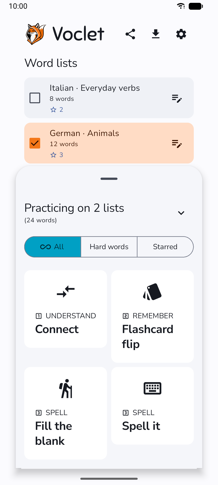
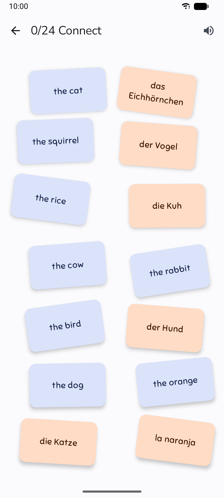
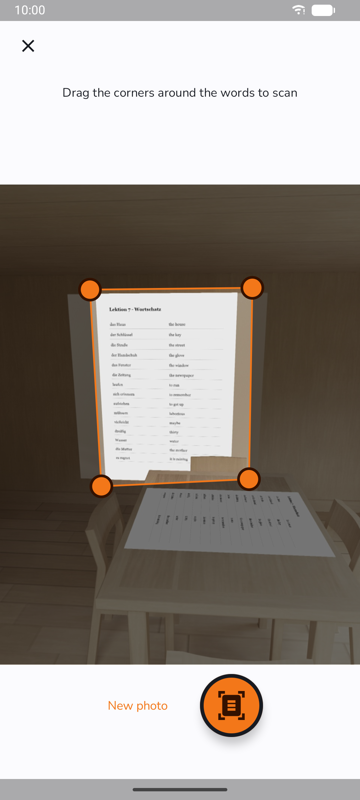

<p align="center">
  
</p>

<h1 align="center">Voclet</h1>

A vocabulary learning app for Android, made for tablets and working on phones. Word lists are
practised in four playful modes; lists can be typed, imported, or photographed from a workbook.
No account, no server, no ads.

<p align="center">
  
  
  
</p>

More screenshots, for phone and tablet, are in the
[store listing images](fastlane/metadata/android/en-US/images/).

## Features

- **Four practice modes:** Connect (draw lines between word and translation), Flashcards, Fill the
  blank (drag the missing letters), Spell it (type the word, see a letter-by-letter comparison).
- **Focus:** practise one list or several, only starred pairs, or the "hard words" you got wrong
  recently. Words are read aloud with the device's text-to-speech voices.
- **Camera import:** photograph a vocabulary page, mark the area, review the pairs in the editor.
- **Translation suggestions** while typing a pair.
- **Optional AI, your choice:** small models that run fully on the device, or a cloud provider with
  your own API key (Google Gemini, Groq, OpenRouter, Mistral, or any OpenAI-compatible server).
- **Your data stays yours:** everything is stored on the device; lists export and share as
  `.voclet.json` files; pairs import from CSV.
- **Thirteen languages** for word lists and for the app itself: English, German, French, Spanish,
  Portuguese, Italian, Dutch, Polish, Swedish, Norwegian, Danish, Finnish, Hungarian.

The full description of every screen is in [`docs/product.md`](docs/product.md).

## Install

Download the signed APK from the
[latest GitHub release](https://github.com/mwiest/voclet/releases/latest). Voclet is on its way
to [F-Droid](https://f-droid.org) (in review); Google Play comes later. Android 9 or newer,
64-bit ARM.

### Help bring Voclet to Google Play

Before Voclet can go on Google Play, at least 12 people have to test it there for 14 days. To
help:

1. Join the [Voclet testers group](https://groups.google.com/g/voclet-testers) with the Google
   account your phone's Play Store uses.
2. When the test starts, the group gets a link to join it and install Voclet from Play.
3. Keep the app installed for 14 days, use it as you normally would, and tell us what you notice
   (in the group or as a [GitHub issue](https://github.com/mwiest/voclet/issues)).

## Build

Requires JDK 21 and the Android SDK with NDK `28.2.13676358`.

```bash
git clone --recursive https://github.com/mwiest/voclet.git   # or: git submodule update --init --recursive
./gradlew :app:assembleDebug
./gradlew :app:test
```

llama.cpp and ncnn are built from source (`third_party/`), so the first build takes about an hour.
How to run the device tests is in [`docs/testing.md`](docs/testing.md).

## Documentation

- [`docs/product.md`](docs/product.md): what the app does
- [`docs/architecture.md`](docs/architecture.md): how the code is organised
- [`docs/decisions/`](docs/decisions/): why it is built this way
- [`docs/roadmap.md`](docs/roadmap.md): what comes next
- [`AGENTS.md`](AGENTS.md): conventions for contributors, human or AI

## Contributing

Issues and pull requests are welcome at <https://github.com/mwiest/voclet/issues>. Translations
other than German are machine-made so far; corrections from native speakers are especially
welcome.

## Licence

Apache License 2.0, see [`LICENSE`](LICENSE). Bundled fonts and emoji are listed in
[`licenses/README.md`](licenses/README.md). The privacy policy is in
[`PRIVACY_POLICY.md`](PRIVACY_POLICY.md).
